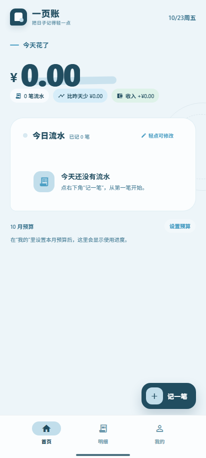
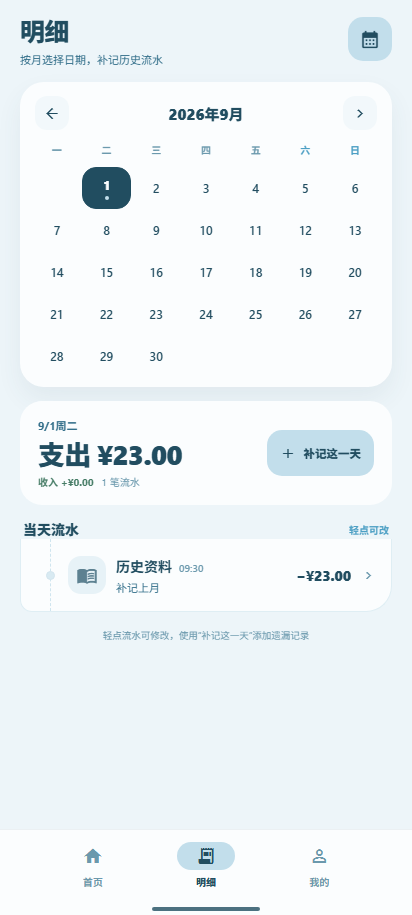
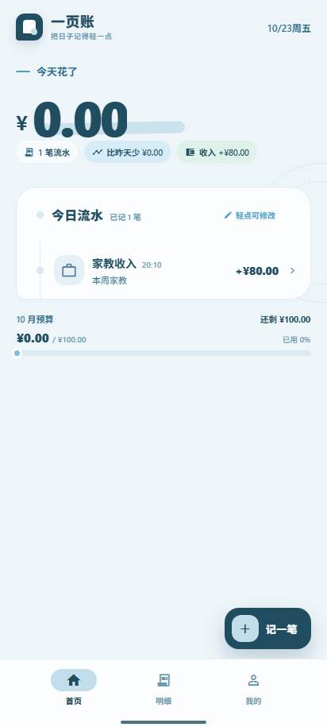
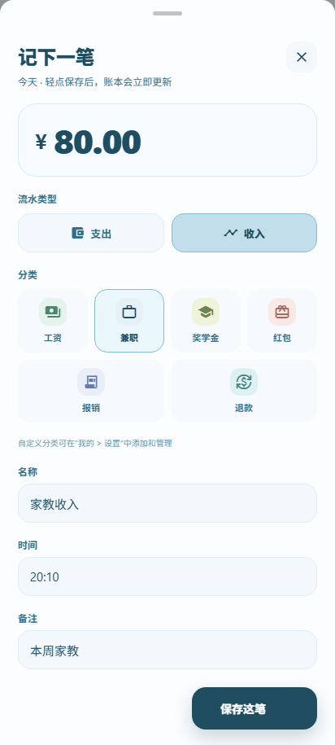
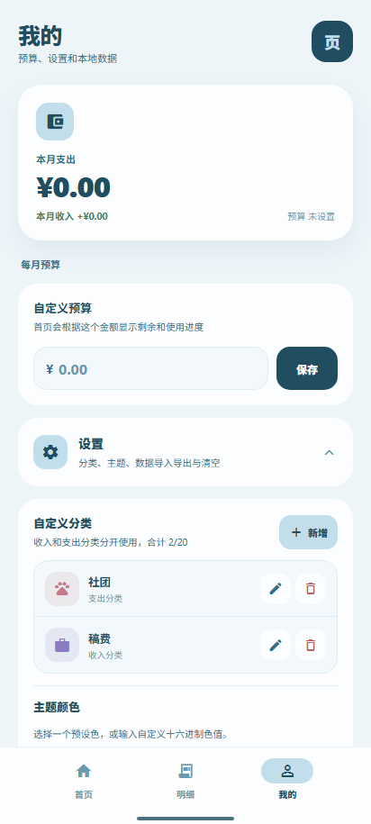
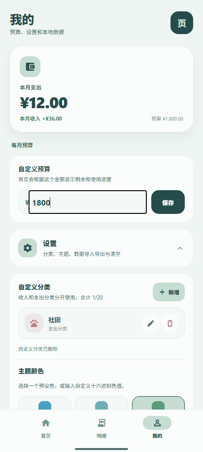

# 一页账

面向大学生的轻量记账 App，以「今日账页」为核心体验，强调快速记录、清晰汇总和可自定义的界面。
基本上是AI帮忙写的可能会有一些小问题

## 功能

- 首页只展示和新增今天的流水，轻点流水即可修改分类、名称、金额、时间和备注
- 明细页使用月历查看并编辑今天及过去任意一天的流水，未来日期不可选
- 在无流水日期可直接补记，日期自动使用月历选中日
- 流水支持支出和收入，首页、明细及月度概览分别汇总
- 支持最多 20 个收入和支出自定义分类，可配置名称、图标和颜色
- 自定义分类在“我的 > 设置”中集中管理，使用中的分类不可删除
- 首页汇总、月度预算和分类图标自动同步
- 支持多套预设主题和自定义十六进制颜色
- 首次启动为空账本，流水、预算和主题保存在本机
- “我的”页面提供折叠式设置区，集中管理主题、预算与本地数据
- 支持带版本信息的 JSON V2 备份导出、V1 兼容导入和确认后全量替换
- Android 原生 BottomSheet 编辑体验

## 项目结构

```text
design/        首页静态视觉设计稿
ledger-studio/ Expo React Native App
```

## 运行

```bash
cd ledger-studio
npm install
npx expo start
```

Web 预览：

```bash
cd ledger-studio
npm run web
```

## Android

APK 不提交到 Git 仓库，通过 GitHub Releases 发布。

当前版本：`1.3.0 (4)`

包名：`com.yiye.ledger`

下载地址：

https://github.com/white-catyy/yiye-ledger/releases/tag/v1.3.0

ARM64 APK：

https://github.com/white-catyy/yiye-ledger/releases/download/v1.3.0/yiye-ledger-v1.3.0-arm64.apk

## 验证

```bash
cd ledger-studio
npx tsc --noEmit
npx expo export --platform web --output-dir dist
```

交互回归脚本位于 `ledger-studio/scripts/verify-app.mjs`。

## 截图












